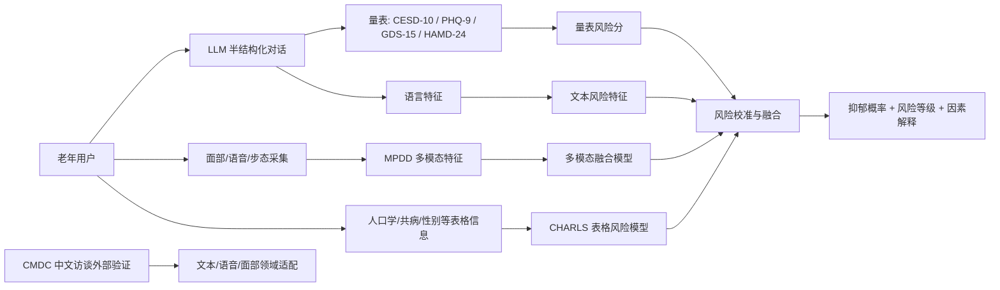

# 老年抑郁风险预测大模型

面向老年人的抑郁风险多模态评估系统：以 CHARLS 问卷/量表数据作为表格基线，以 MPDD 多模态特征（面部、语音、步态、人格）作为行为信号，并用大语言模型完成半结构化对话、量表引导、语言/表情线索汇总和可解释的风险报告。CMDC 中文半结构化访谈数据作为独立外部验证域，不混入老年主队列。

## 整体框架



## 数据来源

- CHARLS：中国健康与养老追踪调查，本机已有 2011-2020 原始数据和 Harmonized CHARLS。项目先用 Harmonized 数据构建“人口学 + 共病 + 功能 + 生活方式 + CESD-10”标准表格集。
- MPDD：Multimodal Personality-aware Depression Detection，面向患有基础疾病的中国老年人，含面部视频、语音、步态、BigFive-10 人格和 PHQ-9 标签。本机数据经官方许可协议申请获得，仅限学术研究，禁止商用或任何形式再分发。原始特征放在 `data/mpdd/`，加载器支持官方 `.npy` 特征目录，可在工作台一键聚合为 `data/mpdd_features.csv` 并训练单模态/融合基线。合规说明见 `docs/07_MPDD数据使用合规.md`。
- CMDC：Chinese Multimodal Depression Corpus，含 78 名混合成人受试者、每人 12 道半结构化访谈题及文本/语音/面部特征。该数据仅用于中文多模态外部验证和领域适配，不是老年专属队列，不进入当前老年风险概率。合规与接入说明见 `docs/21_CMDC中文多模态外部验证接入.md`。

## 快速开始

建议使用已存在的 `torch_env`：

```bash
export PYTHON=/opt/anaconda3/envs/torch_env/bin/python
export PROJECT="$HOME/Desktop/大创/老年抑郁风险预测大模型"

$PYTHON "$PROJECT/scripts/01_build_charls_dataset.py"
$PYTHON "$PROJECT/scripts/03_train_charls_baseline.py"
$PYTHON "$PROJECT/scripts/06_compare_imbalance_methods.py"
```

## 论文与 PDF 渲染

论文章节在 `paper/chapters/`（中文单篇、`zh/`、`en/` 三套），Word 成稿由 `paper/scripts/build_paper_docx.py` 与 `paper/build_docx.py` 生成。macOS 上 LibreOffice 没有“宋体/Arial Unicode MS”，直接导出 PDF 会把中文渲染成方框，重出 PDF 前先跑：

```bash
cd "$PROJECT/paper"
python scripts/prepare_render_fonts.py 老年抑郁风险预测大模型_中文论文.docx /tmp/render_zh.docx
python scripts/prepare_render_fonts.py 老年抑郁风险筛查多模态融合模型论文初稿.docx /tmp/render_single.docx
```

再用 `render_docx.py` 渲染临时副本，并确认 PDF 中嵌入 STSongti 而不是方框。脚本会把系统 Songti 复制进 LibreOffice 内置字体目录，保证后续渲染可复现。

## 前端工作台

桌面入口已放在：

- 带 Logo 的 App：`~/Desktop/老年抑郁风险筛查桌面版.app`
- 命令入口：`~/Desktop/大创/老年抑郁风险预测大模型/scripts/启动桌面App.command`

两者双击都会同时启动后端 API（8001）和前端（8501），并在内嵌 WebView 中打开工作台，不依赖系统浏览器。

App 内的启动器是原生 Mach-O 可执行文件，内部调用 `scripts/desktop_app.py`；
需要重新打包时运行：

```bash
scripts/native_app/build_desktop_app.sh
```

也可以手动启停：

```bash
scripts/start_all.sh
scripts/stop_all.sh
```

也可以手动启动：

```bash
cd ~/Desktop/大创/老年抑郁风险预测大模型
/opt/anaconda3/bin/streamlit run webapp/app.py
```

浏览器打开 `http://localhost:8501`。工作台按角色显示以下页面：

登录与权限：

- 管理员与普通用户通过登录页进入；注册账号默认为普通用户
- 登录和注册均需完成随机加减法人机验证
- 注册时必须设置 3 个密保问题；忘记密码时可凭完整用户名和全部密保答案重置
- 管理员可进入账号管理页创建其他管理员、停用账号和重置密码
- 普通用户只看到风险评估、自己的用户记录和系统说明；数据构建、模型训练、模拟数据与全局统计仅管理员可见
- 所有角色都有“个人主页”，可修改用户名、显示名称、密码和密保问题
- 管理员的“账户管理、个人主页、系统说明”已合并到顶部状态栏左侧的三横线菜单中；普通用户仍保留独立标签页
- 账号、密码哈希与登录会话保存在 `data/auth.sqlite`，老人档案通过 `owner_account_id` 与账号关联
- `data/账号清单.txt` 只保存用户名、角色、状态和时间，不保存密码或密保答案，权限为 `0600`
- 旧版明文密码文件已停用并在启动时安全清除；数据库和账号清单权限限制为 `0600`
- 医学知识库使用 MedlinePlus 官方公开患者教育主题缓存，运行时不向知识库发送用户对话；来源与刷新方式见 `docs/20_MedlinePlus医学知识库接入.md`

- 风险评估：对话访谈 + 量表作答 + 人口学/共病 + OpenFace 表情摘要，实时输出抑郁概率
- 文本风险：规则词典 + LLM/Agent 语言线索置信度混合评分
- 用户记录：用户卡片列表、按姓名/编号查询、点击查看详情、风险趋势图、评估记录按风险/量表筛选、新建/编辑/删除分离；支持全量 JSON 备份与导入恢复；风险评估页可切换当前用户、直接创建用户，并双向同步档案信息
- 评估报告：风险评估页一键导出 Markdown 筛查报告，包含风险构成、语言线索、对话记录与安全提示
- 保存逻辑：相同输入重复点击不会重复入库，保存后自动刷新评估历史，并可一键“保存并查看用户记录”
- 对话导出：温情问询与日常陪伴式聊天均可导出完整对话记录，包含风险线索和安全事件
- 单用户导出：用户记录详情页可一键导出该用户档案与全部评估记录 JSON
- 跨页导航：用户记录页“设为当前用户并去评估”会自动跳转到风险评估页；数据健康页可一键跳转到对应数据构建页
- Agent 透明化：对话接口返回当前引擎（大模型/本地规则）与降级原因；安全表达时提示全国心理援助热线与急救电话
- 系统说明：新增运行状态面板，展示用户/评估数量、用户库大小、后端连接与模型产物时间线
- 前后端自动同步：前端每 10 秒检查后端代码与数据/模型产物签名，检测到更新后自动清空旧缓存、整页重载并提示，无需手动刷新
- 用户风险总览：用户记录页顶部展示用户总数、高/中/低风险人数、评估次数与风险分布图
- 用户记录查询优化：搜索改为前端本地过滤，评估筛选复用已加载历史，减少重复请求
- 数据健康体检：独立页面自动检查 CHARLS / MPDD / CMDC / MODMA / 模拟组 / 用户记录的质量，输出问题与风险提示，并支持导出 Markdown 体检报告
- 统计校正：小样本亚组 Beta-Binomial 概率收缩、MPDD 均值/中位数/截尾均值聚合对比与推荐结论
- 对话意图模型：专业问询/日常陪伴分开训练，覆盖 30 类意图；常见表达走预案，复杂表达继续由 DeepSeek 生成
- Prompt v2：访谈与陪伴系统提示独立版本化，结构化注入对话状态，强制单一关键追问或行动选择，并在接口中返回当前 Prompt 版本
- 回答策略矩阵：7 个核心访谈主题 × 6 类回答，按积极/轻度/中度/重度和回避等情况生成不同的人性化回应
- 临床安全分层：胸痛、卒中征象、跌倒伤情和自伤计划等红旗优先提示紧急/尽快就医；同时支持“没有失眠、不想死”等否定语义，避免假阳性
- 老年人友好交互：侧边栏“关怀模式”可切换大字/高对比界面；量表支持“大按钮作答”；评估结果可一键中文语音朗读
- CHARLS 数据：标准表概览、年龄/共病分布、三类基线模型训练与结果
- CHARLS 个体纵向轨迹：上一波次特征 → 当前波次抑郁，按人分组验证
- 不平衡对比：SMOTE / SMOTE-ENN / ADASYN / 过采样 / 欠采样对比
- 融合校准：用信号概率 + 标签训练学习型融合权重，自动做 Isotonic 校准并展示可靠性曲线
- 数据优化：宽表特征转 Parquet（float32+zstd）分模态缓存，manifest 增量构建，训练自动优先读缓存
- 模拟数据：真实数据特征画像、对话/表格/多模态模拟组单独存放，可与真实组对比、删除；仅用于训练侧实验
- 多模态模拟 v3：层次化合成被试 + 联合潜空间生成，带分布验证门槛和 subject-aware 对比
- 多模态模拟结论：聚合特征上的生成式模拟未通过验证，保留为实验探索；表格与对话模拟组为可行保留项
- 多模态片段级增强：真实片段加小噪声复制，保留被试结构，通过全部分布验证门槛，可作为独立训练参数
- 多模态 gait 优化：gait 噪声调至 0.005 后，gait AUC 反超真实组，整体平均 AUC 略高于真实组
- 多模态科学评估：受试者级 holdout 调参 + 最终测试集验证，真实组仍是最终基准
- MPDD 标签准确性：二分类主分析优先使用官方 `label2`，PHQ-9 阈值只在官方标签缺失时回退；87 名有标签受试者中官方阳性 28 人，旧阈值口径只得到 17 人
- MPDD 正式预测流程：utterance 先按受试者均值聚合，再做 PCA + 强正则化 L2 逻辑回归、单模态等权融合和固定 0.5 阈值；5×5 受试者分组验证融合 AUC 0.627、PR-AUC 0.531、Brier 0.212
- 增量验证：CHARLS 理论基线按受试者分组比较人口学、生物心理社会环境变量、慢病明细和随机森林；MPDD 在 87 名有标签受试者内比较全部 15 种模态组合，并明确标记同人配对与跨源非配对证据边界
- 类别平衡增强实验：face 提升但 gait 验证不过，未采用；官方版本为非平衡片段级增强
- 重复 holdout：5 次 80/20 受试者切分，face 持平、整体平均 AUC 差距约 0.026，可用于参考
- 官方 5 折稳定对比：fusion/personality/face 与真实组几乎持平，audio/gait 略高
- 训练协议：主训练脚本支持 `--train real|synthetic`，模拟组训练 + 真实组验证一键运行
- A/B 对比：文本评分提升明确（AUC +0.048），表格/多模态模拟组与真实训练接近
- 融合权重：已生成融合训练数据模板；完整权重需独立标注的融合训练集
- 部分学习型融合：context 已用 CHARLS 真实校准，mpdd 用 MPDD 真实信号，text 用 LLM 线索；scale 仍为文献先验
- 可解释性与可信度：特征重要性、校准曲线、分层报告、A/B 回归检查历史
- 原始时序模型：v2 深度时序实验（逐折预处理 + 双向 GRU/注意力 + 类别加权）仍弱于聚合特征，subject-aware AUC 0.479、F1 0.057，负结果保留；脚本 `scripts/31b_train_temporal_deep_v2.py` 可复现
- 规模化模拟组：对话 500、表格 2000（追平真实组）、多模态增强 k=3（k=5 略降）
- 增强管线与校准：增强版管线保留为实验；MPDD 校准/DCA 上线；用户记录可积累独立诊断标签并导出融合训练集
- 后端工程：`/api/v1` 版本化、统一错误、请求 ID 日志、CORS 限制、用户存储加锁、模型注册表、`/ready` 就绪检查、API 测试
- 用户数据安全：`GET /api/users/export` 全量导出、`POST /api/users/import` 合并/覆盖导入，支持 JSON 备份与恢复
- 状态统计优化：用户库统计改为 SQL `COUNT` 直接计数，`/api/status` 与自动同步轮询更轻量
- 数据质量检查：`GET /api/data_health` 返回各数据源缺失率、阳性率、模态覆盖、模拟组验证状态与用户记录完整性
- 后台任务：`POST /api/jobs` 提交长任务，`GET /api/jobs/<id>` 查询状态；研究报告缓存、生产启动器、SQLite 备份
- 存储：用户与评估记录正式使用 SQLite，自动从旧 JSON 迁移；前端新增“后台任务”页
- 后台任务页每 5 秒自动刷新；waitress 已安装，生产启动器可直接使用
- 任务系统：进度/阶段/取消/超时/历史持久化，重复任务去重，取消或超时后不会被完成状态覆盖；API 限流与服务端输入校验
- 部署：`scripts/setup.sh` 一键安装，`scripts/start_all_prod.sh` 生产启动，Dockerfile / docker-compose 双服务
- 桌面 App：`~/Desktop/老年抑郁风险筛查桌面版.app`，原生 Mach-O 启动器 + 内嵌 WebView，不依赖浏览器
- 对话模拟组：主题重组 + 风险标签一致性验证通过，可作为 Agent/文本训练参数
- MPDD 多模态：从本地官方特征构建数据表、上传已合并特征，训练单模态/概率后期融合，以及 utterance 级被试分组重复交叉验证基线
- MPDD 进阶评估：label3 三分类、PHQ-9 回归、测试集预测导出、单被试推理
- CMDC 外部验证：加密归档本地读取、受试者级特征聚合、文本/语音/视觉分模态评估、全模态完整病例分析，独立模型不进入老年主评分
- CMDC 稳健性分析：同受试者配对 Bootstrap、95% 置信区间、缺失模态动态融合、嵌套调参多模型比较、校准和决策曲线
- CMDC 锁定留出：固定种子按受试者划分 80/20，阈值只在训练集选择，锁定测试集仅用于最终评估；16 人测试集 AUC 1.000，但精确区间仍宽，不能据此宣称稳定临床性能
- MODMA 辅助语音：52 人、1,508 个 WAV 的结构审计，MFCC/频谱/能量源内基线，以及 MODMA→MPDD 零样本、概率堆叠和联合训练对比；独立页面展示，不进入老年主评分
- 系统说明：模块结构与项目边界

## 后端 API

后端位于 `backend_api/`，提供数据构建、模型训练、量表计分、风险评估和 Agent 对话接口：

```bash
cd ~/Desktop/大创/老年抑郁风险预测大模型
/opt/anaconda3/bin/python backend_api/app.py
```

常用接口：

- `GET http://localhost:8001/api/status`
- `GET http://localhost:8001/ready`
- `POST http://localhost:8001/api/assessment`
- `POST http://localhost:8001/api/charls/train`
- `POST http://localhost:8001/api/charls/train_temporal`
- `POST http://localhost:8001/api/fusion/train`
- `GET http://localhost:8001/api/fusion/status`
- `POST http://localhost:8001/api/mpdd/upload`
- `GET http://localhost:8001/api/cmdc/summary`
- `POST http://localhost:8001/api/cmdc/build`
- `POST http://localhost:8001/api/cmdc/train`
- `GET http://localhost:8001/api/cmdc/report`
- `POST http://localhost:8001/api/cmdc/advanced`
- `POST http://localhost:8001/api/cmdc/holdout`
- `GET http://localhost:8001/api/modma/summary`
- `POST http://localhost:8001/api/modma/audit`
- `POST http://localhost:8001/api/modma/train_audio`
- `POST http://localhost:8001/api/modma/transfer`
- `POST http://localhost:8001/api/agent/chat`
- `GET http://localhost:8001/api/models/list`

Agent 组同学替换 `backend_api/agent_adapter.py` 中的占位实现即可接入真实对话 Agent，详细约定见 `docs/04_后端API与Agent接入.md`。

数据字段模板见 `docs/05_数据接入模板.md`，后期拿到正式数据后直接放入 `data/` 或上传即可。

公开数据集收录与申请指南见 `docs/08_数据集收录与申请指南.md`：公开直接收录采用项为 CLHLS（中国老年跨队列验证）与 HRS/ELSA/SHARE（跨文化敏感性分析）；需申请项含 MPDD-Young/MPDD-AVG-2026、MODMA 等。CMDC 已按 EULA 申请取得，仅作中文多模态外部验证。MPDD 合规红线见 `docs/07_MPDD数据使用合规.md`。桌面导师汇报材料《数据集申请与导师汇报材料.docx》由 `scripts/37_build_dataset_report_docx.py` 生成。

MODMA 已由导师完成申请并确认可用，现作为跨年龄段临床语音辅助数据。原始语音保存为经过 CRC 校验的约 2.5 GB 压缩归档，按需临时解压；它不是老年专属队列，不进入老年主评分。数据边界见 `docs/24_MODMA辅助数据接入与使用边界.md`。

MODMA 首轮语音审计已覆盖 52 人和 1,508 个文件；1,503 段可读，源内 5×5 受试者分组基线 AUC 0.667、PR-AUC 0.706、Brier 0.232、ECE 0.269。当前结论是“可作辅助研究，尚不直接接入主评分”。

MODMA→MPDD 迁移使用相同受试者切分。MPDD 目标域 AUC 0.529，MODMA 概率堆叠 ΔAUC -0.0004，零样本与联合训练更差；因此 MODMA 保留为辅助预训练和鲁棒性数据，不进入当前老年主模型。

数据平滑与统计校正方法、实验结果和边界见 `docs/10_数据平滑与统计校正.md`。

对话快速预案和轻量意图模型见 `docs/11_对话快速预案与意图模型.md`。

真实脱敏对话采集、结构化标注、受试者级切分和三模型对比见 `docs/12_真实对话采集与三模型对比.md`。

训练完成后，模型会保存到 `output/tabular_models/` 和 `output/multimodal_models/`，可直接用 `joblib.load()` 复用。

可选接入大模型摘要：

```bash
OPENAI_API_KEY=sk-... $PYTHON "$PROJECT/scripts/05_run_dialogue_assessment.py" --llm
```

脚本会默认读取：

```text
~/Desktop/大创/中国健康与养老追踪调查数据库（2011-2020官网原始数据初步清洗后）/
  Harmonized CHARLS/
    H_CHARLS_D_Data-cleaned/clean_H_CHARLS_D_Data.dta
```

## 目录结构

```text
.
├── docs/                      # 总体方案、数据说明、不平衡处理
├── data/                      # 生成的标准表格数据；MPDD 特征放 data/mpdd
├── src/elderly_depression/    # 可复用模块
├── scripts/                   # 从建表到训练、到端到端演示的脚本
└── tests/                     # 单元测试
```

## 路线

1. CHARLS 建表与表格风险基线（已完成可运行脚本）
2. MPDD 本地数据解析、单模态/多模态基线（已完成特征接入、subject-aware 基线、三分类/回归、推理导出）
3. LLM 对话模块与量表动态引导
4. 多模态 + 表格 + 语言风险融合
5. 类别不平衡优化、SHAP 解释和在线 Demo
